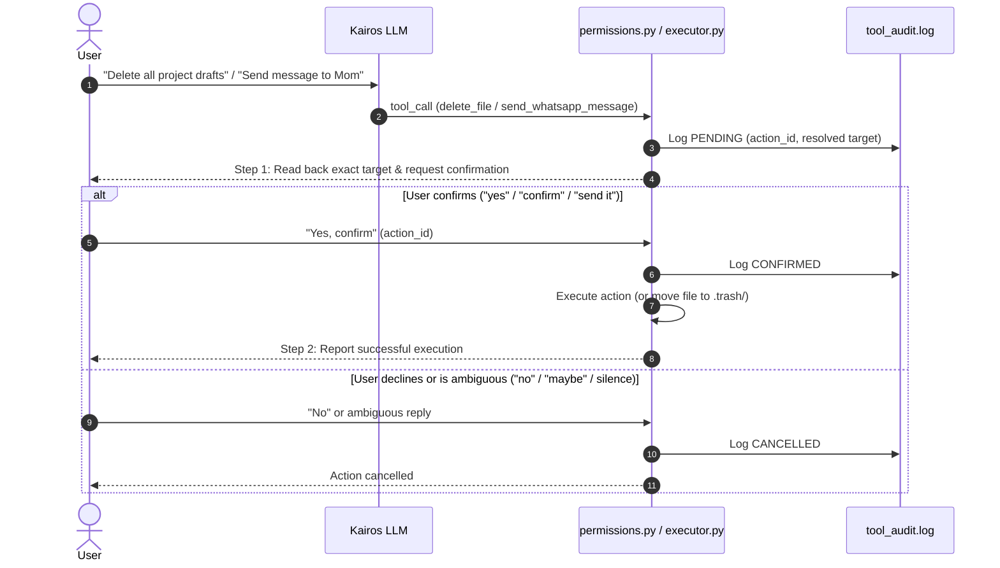

# Kairos Security & Permission Architecture

Kairos employs a defense-in-depth security model with three non-negotiable layers of protection. These layers cannot be disabled or bypassed by runtime configuration, plugins, LLM system prompt manipulation, or user voice instructions. They are enforced in code at the lowest execution layer before any OS or browser tool executes.

---

## Layer 1: Tool Execution Allowlist & Parameter Constraints (Part A)

All tool invocations are checked against an explicit allowlist in `backend/agent_tools/permissions.py`.

### 1. Permitted Tools
Only the following tools may be invoked by Kairos:
- **Generic Browser Primitives:** `navigate_to`, `find_and_click`, `type_into`, `scroll_page`, `extract_page_text`, `read_page`, `go_back`, `open_new_tab`, `switch_tab`
- **Backward-Compatible Shortcuts:** `open_youtube_in_brave`, `youtube_search`, `youtube_play_video`, `youtube_control`, `search_and_play_youtube`
- **Desktop Applications & OS Controls:** `open_app`, `close_app`, `cursor_control`, `type_in_active_window`, `open_notepad_and_write_code`, `open_vscode_and_write_code`, `write_and_run_sandbox_code`, `work_mode`
- **Communication & File Operations:** `check_whatsapp_notifications`, `send_whatsapp_message`, `send_email`, `delete_file`

Any tool name outside this allowlist is immediately rejected with a structured `PERMISSION_DENIED` error and logged to `backend/logs/tool_audit.log`.

### 2. Workspace Directory Containment
- File-writing and creation tools (`open_notepad_and_write_code`, `open_vscode_and_write_code`, `delete_file`) are strictly confined to the user workspace directory:
  - **Default Path:** `~/KairosWorkspace`
  - **Environment Override:** `KAIROS_WORKSPACE_DIR`
- Path traversal sequences (e.g. `../../etc/passwd`, `..\..\Windows`) and absolute paths outside the workspace are blocked before file creation or opening.

### 3. Command Execution & Metacharacter Sanitization
- **Strict Mode (Default):** Sandbox executions only permit recognized base commands (`python`, `node`, `npm`, `git`, `echo`, `ls`, `dir`, `cat`, `type`) and reject shell metacharacters (`;`, `&`, `|`, `` ` ``, `$`, `>`, `<`, `\n`, `\r`).
- **Trusted Mode:** Configured via `KAIROS_SECURITY_MODE=trusted`. Relaxes the general command allowlist for advanced developers, but **CANNOT bypass Layer 2 (Confirmation) or Layer 3 (Protected Zone)**.

---

## Layer 2: Mandatory Two-Step Confirmation Flows (Parts B & E)

Destructive actions and outbound communications require explicit, unambiguous human confirmation before execution.



### 1. Destructive Actions (Part B)
- **Scope:** File deletion (`delete_file`), database clear (`clear_history`), memory truncation, browser account deletion/unsubscription clicks, and destructive commands (`rm -rf`, `del /f`, `git reset --hard`, `git push --force`).
- **Target Resolution:** The prompt read back to the user is constructed from the **actual resolved file path or database record count**, never from the LLM's unverified summary.
- **Confirmation Requirement:** Requires an unambiguous affirmative token (`yes`, `confirm`, `proceed`, `delete it`). Generic previous affirmations, wake-words, or ambiguous replies (`maybe`, `ok later`) cancel the operation.
- **Grace-Period Trash Recovery:** Deleted files are moved to `~/KairosWorkspace/.trash/<timestamp>_<filename>` with preservation metadata rather than being permanently unlinked.

### 2. Outbound Communications (Part E)
- **Scope:** Outbound messaging via WhatsApp (`send_whatsapp_message`), email (`send_email`), SMS, or social media postings.
- **Readback Guarantee:** Kairos reads back the **exact resolved recipient** and **exact verbatim text content**.
- **Contact Disambiguation:** If a recipient query matches multiple contacts or is ambiguous, Kairos stops and asks the user to choose before drafting or confirming.

---

## Layer 3: Permanently Protected Zone (Part C)

Hardcoded in `backend/agent_tools/protected_zone.py`. This zone is permanently inaccessible to Kairos in all execution modes, regardless of confirmation or user prompts.

| Category | Protected Targets | Behavior |
|---|---|---|
| **OS System Files** | `C:\Windows`, `System32`, `SysWOW64`, `C:\ProgramData\Microsoft`, `/etc`, `/usr/bin`, `/bin`, `/sbin`, `/System`, `/Library`, `/root`, `/dev`, `/proc` | **HARD BLOCK:** Never readable, writable, or executable by Kairos. |
| **Credentials & Secrets** | `backend/.env`, any `.env*`, `~/.ssh/*`, `id_rsa`, `id_ed25519`, `*.pem`, `*.key`, `*.pfx`, `*.crt`, `~/.aws/*`, `~/.gnupg/*`, `~/.config/gcloud/*`, Browser `Login Data`, `Cookies` | **HARD BLOCK:** Never accessible or modifiable. |
| **Kairos Security Core** | `backend/logs/tool_audit.log`, `backend/agent_tools/permissions.py`, `backend/agent_tools/protected_zone.py`, `backend/agent_tools/audit_logger.py`, `backend/agent_tools/SECURITY.md` | **HARD BLOCK:** Kairos cannot tamper with its own security enforcement or audit trails. |
| **Financial & Payment Actions** | Payment submissions, "Pay Now", "Buy Now", "Confirm Purchase", "Checkout", Credit/Debit card numbers, CVV, bank account numbers | **HARD BLOCK:** Kairos is prohibited from entering payment credentials or completing purchases. Purchases must be performed manually by the human. |
| **User Protected Paths** | Defined in `backend/config/protected_paths.txt` (e.g. `~/Documents/PersonalVault`, `/secure/data`) | **WRITE/DELETE BLOCK:** Protected from modification or deletion. |

---

## Audit Logging & Tamper Evidence

Every security event is logged in append-only JSON Lines format to `backend/logs/tool_audit.log`:

```json
{
  "timestamp": "2026-08-26T11:15:30.123456+00:00",
  "epoch": 1787742930.123,
  "severity": "SECURITY_ALERT",
  "event_type": "PROTECTED_ZONE_BLOCKED",
  "tool_name": "open_notepad_and_write_code",
  "target": "f:\\Personal Assistant\\backend\\.env",
  "outcome": "BLOCKED",
  "details": {
    "reason": "Target path matches protected security file."
  }
}
```
